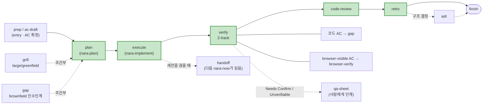
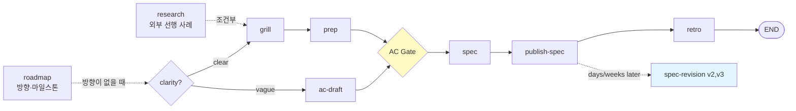

# nara-kit skills

**60 skills**, grouped below. Invoke explicitly (`/nara-<skill>`, Codex는 `$nara-<skill>`) or via natural-language trigger (each skill's `USE FOR` keywords). 흐름상 다음에 뭘 할지는 `nara-now`가 알려준다.

← Back to [root README](../README.md).

## Catalog / 카탈로그

묶음은 **하고 싶은 일** 기준이다(라이프사이클 단계가 아니라). 한 스킬은 한 묶음에만 있다. 마지막 묶음 **Multica 연동**은 [Multica](https://github.com/multica-ai/multica) CLI와 데몬 없이는 동작하지 않는 스킬이라 일반 소비자는 건너뛴다. 묶음 ↔ 디렉터리 ↔ 스킬 수의 정합성은 `tools/check-docs.py`가 검사한다.

### 준비·기획 / Prepare & Plan

요구사항을 로컬화하고, 설계를 찌르고, 작업 단위로 쪼개고, 결정을 문서로 남긴다.

| Skill | Description / 설명 |
|-------|---------------------|
| `nara-prep` | Localize external SoT (Jira/Figma/Confluence) into `docs/requirements.md` + Readiness score / 외부 SoT 로컬화 + 충분성 판정 |
| `nara-ac-draft` | Generate User Stories + Gherkin AC from one-line intent (no external SoT). Sister of `prep` / 한 줄 의도 → US + Gherkin AC 생성 (외부 SoT 없을 때) |
| `nara-grill` | Pressure-test an idea/design/plan — fact-first, every answerable decision per round (설계 탐색 단계) / 사실 조사 후 답할 수 있는 결정을 한 라운드에 묻고 의존 질문만 미룸 |
| `nara-research` | Compare external prior art for one pending decision, or distill a source skill/repo into keep/adapt/omit (every source pinned to a revision) → `docs/research/*.md` / 결정 하나를 위한 외부 선행 사례 비교 또는 남의 스킬·repo 증류. 제안만, 적용은 skill-forge·adr |
| `nara-ask-repo` | Answer one concrete question about a repo's behavior — this repo, another checkout, or a remote GitHub repo pinned to a commit — read-only, `path:line` beside every claim / 저장소 동작 질문 하나에 근거로 답한다 (값 출처·존재 여부·영향 범위·책임 위치, 다른 저장소도) |
| `nara-roadmap` | Turn an unclear situation into a constraint-aware roadmap: frontier-round interview, fixed/negotiable/unknown constraints, milestones with completion evidence, recurring ops apart, no-go is a valid end; chat by default, saved on request / 불분명한 상황 → 제약 기반 로드맵 (repo 없는 기획도). 대화 기본, 요청 시 `docs/plan/roadmap-*.md` |
| `nara-plan` | Split a spec into independently verifiable vertical work units → `docs/plan.md` / 스펙을 독립 검증 가능한 수직 작업 단위로 분할 |
| `nara-rfc` | Write RFC document in Korean Markdown / RFC 문서 작성 |
| `nara-adr` | Architecture Decision Record / 아키텍처 결정 기록 |
| `nara-claim-audit` | Audit numeric claims in a spec against CSV snapshots (script-owned, deterministic) / 기획서 수치 주장을 CSV와 대조 — 스크립트 소유·결정론 |
| `nara-publish-spec` | Publish spec to Confluence wiki / 스펙 → Confluence 게시 |
| `nara-spec-revision` | Revise and version specs with review feedback, append to Confluence / 스펙 리비전 + Confluence 버전 관리 |

### 구현 / Build

코드를 바꾸고, 커밋 메시지를 만들고, 충돌과 장애를 처리한다.

| Skill | Description / 설명 |
|-------|---------------------|
| `nara-implement` | Gated code implementation (strategy approval → TDD option → verify → stop at staged, never auto-commit) — 구현 단계 / 검증 게이트 구현 (전략 승인·TDD 옵션·자동 커밋 없음) |
| `nara-commit` | Generate conventional commit message with ticket ID / 커밋 메시지 생성 |
| `nara-wt` | Create git worktree for a Jira ticket (`{repo}-{ticket}-{slug}`) — fetches summary, generates slug, asks for git type prefix / Jira 티켓 기반 worktree 생성 |
| `nara-merge-conflict` | Resolve merge/rebase conflicts by reconstructing ours/theirs intent per hunk, human-decided / 머지·리베이스 충돌 의도 기반 해결 |
| `nara-incident` | Structured incident analysis report with red-capable reproduction gate (no code changes) / 재현 게이트 기반 장애 분석 리포트 (코드 수정 없음) |
| `nara-incident-fix` | TDD-based fix from `docs/incident-report.md` / 장애 리포트 기반 TDD 수정 |

### 검증 / Verify

요구사항 대비 진행률, 브라우저 런타임, 테스트 시나리오, 화면 회귀를 확인한다.

| Skill | Description / 설명 |
|-------|---------------------|
| `nara-gap` | Requirements vs implementation gap analysis → `docs/gap.md` (0-100 score) / 요구사항 vs 구현 갭 분석 |
| `nara-browser-verify` | Judge browser-visible AC against a headless runtime — per-axis verdict from trusted input, network req/res, inspected screenshots / 브라우저 AC 런타임 판정 (축별 증거 기반) |
| `nara-qa-sheet` | Single-file HTML checklist of screens a human must check by hand, for AC automation left `Unverifiable` / 자동 검증이 못 닿은 화면의 수동 QA 체크리스트 (체크·메모 브라우저 저장) |
| `nara-test-discover` | Discover test scenarios for a feature or file / 테스트 시나리오 발굴 |
| `nara-test-verify` | Review and validate test scenarios (3-persona review) / 테스트 시나리오 검증 |
| `nara-test-implement` | Implement tests from scenario documents / 시나리오 기반 테스트 구현 |
| `nara-golden-path-discover` | Discover live golden-path E2E scenarios + Playwright-ready export / 라이브 골든패스 E2E 발굴 + Playwright export |
| `nara-ui-diff` | Env-diff visual regression: QA/Prod baseline vs local target computed-style + rect diff (candidates only) / 환경 간 UI 회귀 비교 — computed-style·bounding-rect 차이 후보 |
| `nara-local-shot` | Screenshots of locally-running web apps (SSO-gated via dummy-cookie bypass) for PR visual comparison / 로컬 앱 스크린샷 캡쳐 |
| `nara-prototype` | Throwaway prototype (2 UI variants or a logic harness) to answer one decision question: hypothesis and criteria first, fake/real boundary, `## Tested` run receipts, `## Confirmed` report, verdict Pass/Fail/Blocked/Unverifiable / 결정 하나를 위한 일회성 프로토타입 + 판정 리포트 |

### 리뷰·PR·릴리즈 / Review, PR & Release

로컬 변경과 원격 PR을 리뷰하고, PR을 열고 대응하고, 릴리즈를 준비해 태그까지 간다.

| Skill | Description / 설명 |
|-------|---------------------|
| `nara-code-review` | Evidence-based multi-agent review (core 4 + conditional 7, Reviewer→Judge→Fixer→Verifier) / 증거 기반 멀티에이전트 코드 리뷰 |
| `nara-adversarial-review` | Attack an existing review report (refuter / blind hunter / rigor auditor), append-only / 리뷰 리포트 공격 검증 |
| `nara-pr` | Generate PR title and body in Korean / PR 제목 + 본문 생성 |
| `nara-pr-review` | Remote PR review via gh (code plane + PR plane: description/commits/CI/discussion), approval-gated comments / 원격 PR 리뷰 |
| `nara-pr-respond` | Respond to PR review comments (accept/rebut/hold) / PR 리뷰 코멘트 대응 |
| `nara-release-prep` | One-shot release prep: merged-PR diff → release branch recreate → QA deploy dispatch → Jira Fix Version append / 원샷 릴리즈 준비 (PR 수집 → pre-release 재생성 → QA 배포 → Fix Version) |
| `nara-release-finalize` | Merge PR open + release note draft, then tag + push gated behind explicit confirm (triggers prod deploy). Sister of `release-prep` / 머지 PR + release note 초안, 태그 push는 확인 게이트 (prod 배포 트리거) |

### 디자인 / Design

디자인 시스템 위에서 화면을 만들고, AI가 읽을 디자인 스펙을 유지한다.

| Skill | Description / 설명 |
|-------|---------------------|
| `nara-design-studio` | Design/prototype product screens on any design system via a pluggable pack: interview → Studio candidates → element-comment refine → implementer handoff (real pack components, anti-drift) / 팩 교체형 디자인 스튜디오 — 인터뷰→후보→코멘트 리파인→핸드오프 |
| `nara-design-pack-builder` | Extract a design-studio DS pack (tokens + standalone component bundle + manifest) from a React design system, guided React-first protocol / React 디자인시스템에서 design-studio 팩 추출(가이드 프로토콜) |
| `nara-design-md` | Adopt, update, or audit a DESIGN.md — AI-readable design spec / AI용 디자인 스펙 생성·갱신·감사 |

### 글쓰기·설명 / Writing & Explain

남에게 보여줄 글을 만들거나 고친다.

| Skill | Description / 설명 |
|-------|---------------------|
| `nara-explain` | Shareable explanations for different audiences / 대상별 설명 문서 생성 |
| `nara-eli5-note` | ELI5-or-practitioner note into Obsidian with mandatory HTML/SVG diagrams (never ASCII/mermaid) — tone asked first, vault conventions respected / 쉬운 설명 + HTML/SVG 그림을 Obsidian 노트로 저장 |
| `nara-humanizer` | Detect AI writing patterns in Korean text and rewrite as natural prose (KatFishNet 94.88% AUC, 41 patterns) / 한국어 AI 작문 패턴 감지 + 윤문 |
| `naranizer` | Rewrite AI-drafted Korean text into the user's own measured style from a local profile (register auto-detect, fact-preserving) / 실측 프로필 기반 개인 말투 변환 |
| `nara-ko-prose` | Repair Korean prose in shared artifacts — restore dropped particles/endings, complete noun-phrase sentence breaks, replace em-dashes. Applies snflkd/fluent-korean (MIT) by reading the installed rules file; ships no copy / 공유 문서 한국어 명확성 수리 |
| `nara-rewrite` | Meaning-preserving rewrite for a reader without the context (Korean/English): modality, intensity, tense and evidence kept; returns one clean rewrite, `review` mode returns findings / 맥락 모르는 독자용 의미 보존 재작성 (재작성 한 벌만, review는 지적만) |

### 세션·툴킷 / Session & Toolkit

세션의 시작과 끝, 기억의 유지, 그리고 nara-kit 자체를 다듬는다.

| Skill | Description / 설명 |
|-------|---------------------|
| `nara-now` | Session state assessment + next action / 세션 상황 판단 + 다음 행동 추천 |
| `nara-handoff` | Record where the session stopped into `docs/handoff.md` (merge with the previous one; deleted when nothing is left) — read first by the next `nara-now` / 하다 만 일·열린 질문·검증 상태 인계 |
| `nara-retro` | Session retrospective and skill-incident diagnosis: evidence chain per lesson, smallest prevention routed to its owner (memory write; checks/rules/skills/ADR suggest-only), redacted proposals for nara-kit itself / 세션 회고 + 스킬 장애 진단 → 재발 방지 처분 |
| `nara-grooming` | Audit persistent instructions — memory, CLAUDE.md/rules, skills — for duplicates, conflicts and stale overrides; per-tier approval, backup before touching files outside git / 메모리·규칙·스킬의 중복·충돌·낡은 지침 감사 |
| `nara-skill-forge` | Improve and harden skills via Waza static analysis + EPT subagent execution / Waza+EPT 통합 스킬 개선 |
| `nara-empirical-prompt-tuning` | Iteratively improve prompts via bias-free executor testing — via [@mizchi](https://github.com/mizchi/skills/blob/main/empirical-prompt-tuning/SKILL.md) / 프롬프트 경험적 튜닝 |

### 연동·자동화 / Trackers & Scheduled

Jira·Slack과 주고받거나 주기적으로 돈다. 스케줄 호스트(cron, CronCreate, Multica)는 선택이고 스킬 자체는 호스트 없이도 한 번 실행된다.

| Skill | Description / 설명 |
|-------|---------------------|
| `nara-slack-to-jira` | Turn Slack thread permalinks into Jira tickets (classify Bug/Feature, dedup, draft → approve → create, English content) / 슬랙 스레드 → Jira 티켓 |
| `nara-wip-sweep` | Sweep assigned tickets stuck at an in-progress status, classify each by measured evidence (merged/open PR by word-boundary key match, subtask container, missing AC, days idle), and report cleanup candidates. Never transitions a ticket / In Progress 상태 부채 일괄 분류 → 정리 후보 보고 (전이는 사람) |
| `nara-worklog` | Reduce the hook-collected session-timestamp ledger into per-day Jira worklog entries behind a human confirm gate (idle-split, midnight-split, worktree union, floor-to-minute, watermark idempotency). Needs one-time hook setup / 세션 타임스탬프 → 날짜별 Jira worklog (승인 게이트) |
| `nara-trending-digest` | Crawl GitHub Trending weekly, LLM-filter for AI/LLM + DX tools, post digest to Slack DM + Obsidian / GitHub 트렌딩 주간 크롤 → 필터링 → Slack DM + Obsidian |
| `nara-release-watch` | Two-stage watchlist follow-up: daily **watch** reports what shipped with machine-filtered highlights (no judgment, silent on quiet days) and queues items; weekly **digest** judges the accumulated queue (`이미 있음`/`의존`/`증류 후보`/`무시`, default `의존`, cross-repo patterns allowed). Pairs with `trending-digest` (unknown-repo discovery) / watch=릴리즈 알림+큐 적재, digest=누적 증류 판정 |

### Multica 연동 / Multica-dependent

`multica` CLI와 데몬이 **필수**다. Jira 티켓과 PR 리뷰를 Multica 보드의 카드로 다루는 개인 운영 흐름이라 일반 소비자에게는 해당 없다. 설치 후 이 다섯 디렉터리를 지우거나 처음부터 `--skill`로 골라 설치한다. 소속 표지는 프론트매터 `metadata.nara.scope: multica`이고 `tools/check-docs.py`가 묶음과 태그의 일치를 검사한다.

| Skill | Description / 설명 |
|-------|---------------------|
| `nara-jira-triage` | Poll Jira for tickets assigned to you, classify 구현/버그픽스/기획/기타, emit a Multica issue with a ready-to-run launch kit (never executes code) / 내 Jira 티켓 폴링 → 분류 → 런치킷 Multica 이슈 발급 |
| `nara-jira-drain` | Launch a chosen jira-triage queue ticket into an aoe session (group + worktree), drive the work to a PR — interactive ($0), human-triggered / 큐 티켓 1건 → aoe 세션 착수 → PR까지 자율 (인터랙티브 $0) |
| `nara-review-reminder` | Find PRs where you are a requested reviewer but haven't reviewed yet → create Multica reminder issues / 미리뷰 PR 탐지 |
| `nara-review-queue` | Drain Multica "리뷰 필요" reminder issues → trigger built-in `/review` per PR, write verdict back as issue comment (read-only). Consumer pair of `review-reminder` / 멀티카 리뷰 큐 드레인 |
| `nara-pr-activity-reminder` | Record PR activity onto the Multica card that already owns that PR — the work card for a PR you opened, the verdict card for someone else's. Creates no cards. Fully deterministic, so the spec here is executed by an out-of-band cron script, not an LLM autopilot / PR 활동을 그 PR의 기존 카드에 기록 (PR 1건 = 카드 1장, 생성 안 함, 실행은 크론 스크립트) |

## Usage / 사용법

**Slash command (명시 호출)** — 정확히 그 스킬만: `/nara-now`, `/nara-prep PROJ-1234`, `/nara-code-review`.

**자연어 트리거 (라우팅)** — Claude가 `description`의 `USE FOR` 키워드로 자동 매칭: `"어디까지 했지"` → nara-now, `"요구사항 정리해줘"` → nara-prep, `"리뷰해줘"` → nara-code-review.

**명시 호출 전용** — 원격에 쓰는 여섯 스킬은 자연어로 안 불린다: `publish-spec`, `spec-revision`(Confluence), `slack-to-jira`, `worklog`, `jira-triage`(Jira·Multica), `release-finalize`(태그 push, prod 배포). 모델이 "준비됐어 보인다"는 판단으로 게시·배포를 시작하지 못하게 하려는 것이다. 대가로 이 여섯의 description은 컨텍스트에 실리지 않아 USE FOR 매칭이 없다. Claude Code는 `disable-model-invocation: true`, Codex는 `agents/openai.yaml`의 `allow_implicit_invocation: false`로 걸고, 둘이 어긋나면 `tools/check-docs.py`가 실패한다.

**워크플로우 진입**: **`nara-now`** — 상태를 보고 다음 행동을 명령 형태로 제시한다. 워크플로우 진입용 별도 스킬은 없다.

**첫 사용 권장 순서**: `nara-now` (상태 점검) → `nara-prep <TICKET>` (요구사항 로컬화) → `nara-plan` (작업 단위) → `nara-implement` → `nara-gap` (verify) → `nara-code-review` → `nara-pr` → `nara-worklog` (Jira 시간 기록, 미기록분은 `nara-pr`이 알려준다).

## Workflow / 워크플로우

아래는 **권장 흐름이지 실행되는 스킬이 아니다.** 각 단계는 개별 스킬을 직접 호출(`/nara-<name>`)하며, "지금 어디고 다음이 뭔지"는 `nara-now`가 답한다.

> 2026-08-14: 흐름을 소유하던 메타 스킬 4종(`orchestrator`·`dev-mode`·`doc-mode`·`viz`)을 제거했다. 실사용 측정 결과 60일간 합계 1회 호출(3종은 0회)이었던 반면, 실제로 도는 것은 개별 스킬 직접 호출과 `nara-now`(74회)였다. 흐름을 스킬로 포장하면 아무도 부르지 않는다는 것이 측정의 결론이다. `dev-mode`가 들고 있던 Implementation Notes Gate 계약은 `nara-implement`로 이관됐다.

> 아래 다이어그램·표의 스킬 이름은 짧은 표기 — 실제 설치·호출명은 `nara-<name>` (예: `gap` = `nara-gap`).

### 개발 흐름 (권장 순서)

**핵심 5단계 (각 단계가 인간 검증 재료를 산출):** `plan → execute → verify → code-review → retro`

- **진입 (조건부)**: 외부 SoT 있으면 `prep`, 한 줄 의도면 `ac-draft`. AC Gate 통과 후 아래 순서.
- **조건부 satellites**: `grill`(large/greenfield 설계 검증), `gap`(brownfield 인수인계 — 구현 전 진행률 파악이 먼저 필요할 때만), `adr`(구조 결정 시), impl-notes(medium/large — `nara-implement`가 소유). `small`/bugfix는 전부 skip하고 5단계 직행.
- **verify는 2-track**: 코드 AC는 `gap`(이 시점에 `gap.md` 생성+판정 1회), `browser-visible: yes` AC는 `browser-verify`(런타임 증거 기반 축별 판정). 두 트랙이 판정 못 한 항목(gap의 `Needs Confirm`, browser-verify의 `Unverifiable`)은 `qa-sheet`가 사람이 볼 체크리스트로 넘긴다(판정이 아니라 인계). gap이 spine 맨 앞에서 빠진 이유는 `docs/adr/0001-verify-browser-ac-at-runtime.md` (repo-local, 배포 대상 아님).
- **plan = `nara-plan`** (수직 작업 단위 → `docs/plan.md`), **execute = `nara-implement`** (검증 게이트 + TDD 옵션, 자동 커밋 없음 → `/nara-commit`).
- **plan 승인**은 plan 단계에 흡수 (별도 pre-execution phase 없음). 완료 전 AI 점수 판정 단계는 제거됨 (AI-as-judge 안티패턴 — `verify` + `code-review`가 검증 담당).

### 기획 흐름 (권장 순서)

- **Revision loop**: `publish-spec` 이후 피드백 수집되면 별개 세션에서 `/nara-spec-revision <URL>` — 라운드마다 버전 append (워크플로 재진입 아닌 standalone).
- `adr`(구조 결정), `rfc`(기술 결정)는 필요 시 spec 산출 후 호출.
- `roadmap`은 방향 자체가 아직 없을 때 기획 흐름 맨 앞에서 부른다. 대화로 끝나는 것이 기본이고, 저장하면 `docs/plan/roadmap-<slug>.md`. 고른 단계는 `ac-draft`·`grill`·`plan`으로 이어진다.
- `research`(외부 선행 사례 비교, 남의 스킬·repo 증류)는 결정 하나가 외부 근거에 걸릴 때 `grill` 앞에서 호출. 산출물은 제안이고 적용은 `skill-forge`·`adr`이 한다.

**Legend**: 🟢 green border = 핵심 5단계 · 🟡/🔴 = gate / block. 전부 개별 스킬 직접 호출이다.

## Gates / 게이트

워크플로우 강제 지점. 통과 못하면 다음 단계 진입 차단.

| Gate | Where | Mechanism | 강도 |
|------|-------|-----------|------|
| **AC Gate** | `prep` / `ac-draft` (plan 진입 전) | `## Acceptance Criteria` 비면 차단. Gherkin 빈 템플릿만 제시. SoT에 AC 있으면 자동 통과 | ★★★★ |
| **P0 Hard Gate** | `gap` | P0 Missing ≥ 1이면 점수 무관 차단. 점수 ≥ 80 + P0 0건만 review-ready | ★★★★ |
| **Plan Approval** (folded) | `plan` (단계 내) | plan에 흡수된 AskUserQuestion 승인 전 코드 변경 금지. 별도 phase 아님 | ★★★★ |
| **Implementation Notes Gate** (scope-scaled) | `implement` (medium/large) | medium/large만: impl-notes 생성 + `📝 notes:` trailing + verify 빈 notes reject. `small` skip | ★★★ |
| **Fix-Ledger Verification** | `code-review` (fix 라운드마다) | 라운드 시작 파일 hash 스냅샷 → issue 단위 hunk·validation proof 대조 (claimed-but-unchanged / changed-but-unclaimed / changed-but-unresolved), mismatch → escalate + trailing status | ★★★ |
| **Notes Reconciliation** | `gap --verify` | impl-notes Deviations ↔ gap Missing 매칭 → Agreed Exception 후보. Open Q [revise] → Spec Revise Candidates | ★★★ |
| **Readiness Gate** | `prep` | 4기준 (Functional / UNVERIFIED / blocking-Q / Goal) 충족으로 다음 단계 분기 | ★★★ |

강도: ★★ 텍스트 룰 · ★★★ trailing/preflight · ★★★★ state file/AskUserQuestion · ★★★★★ hook (shell 강제).

## Artifacts / 산출물

워크플로우가 `docs/`에 생성하는 파일들 (gitignore — per-project 작업물).

| File | Generated by | Purpose |
|------|--------------|---------|
| `docs/requirements.md` | `prep` / `ac-draft` | 외부 SoT 로컬화 + `## Acceptance Criteria`. 모든 후속 스킬의 입력 SoT |
| `docs/sources/<id>.raw.md` | `prep` | 외부 SoT verbatim 원문 (AC 원본 보존) |
| `docs/gap.md` | `gap` | 요구 vs 구현 갭. P0/P1/P2 + Score + Hard Gate. AC 본문 = 자동 P0 |
| `docs/gap-history.md` | `gap` | append-only score-trend 로그 (gen/verify). gap.md 덮어써져도 점수 추이 보존 |
| `docs/plan.md` | `plan` (nara-plan) | 구현 계획 — 독립 검증 가능한 수직 작업 단위 (T-N + AC + 요구사항 추적). `nara-implement`의 입력. (기획 산출물 `docs/plan/*.md` 디렉터리와 구분) |
| `docs/implementation-notes.md` | `implement` (medium/large) | 구현 중 drift log. 4 카테고리: Design / Deviations / Tradeoffs / Open Q. `small`은 skip |
| `docs/handoff.md` | `handoff` | 다음 세션 인계 9-섹션 (검증 상태 + 재현 명령 포함). In Progress + Open Questions surface |
| `docs/test-scenarios/*.md` | `test-discover` / `golden-path-discover` | AC↔시나리오 1:1 매핑, Playwright-ready E2E export |
| `docs/incident-report.md` | `incident` | root cause 가설 + 증거 + 제안 수정 |
| `docs/plan/*.md` | 기획 흐름 | spec / RFC / design artifact (AC 박힌 채) |
| `docs/research/YYMMDD-<slug>.md` | `research` | 결정 하나의 외부 선행 사례 비교 또는 증류 제안. 출처 revision 고정, 인용된 주장, keep/adapt/omit 표. 재조사는 갱신 절 append |

**AC lifecycle**: AC는 모든 스킬의 공유 SoT. `prep`이 외부 SoT의 AC를 **verbatim 보존** → `docs/requirements.md`의 `## Acceptance Criteria`에 박힘 → `gap`(P0 자동분류) / `test-discover`(시나리오 1:1) 가 소비. SoT에 AC 없으면 `ac-draft`가 작성 강제.

## Output Contract / 출력 규약

모든 스킬은 공통 출력 규약을 따름 — 응답은 **영수증(3-6라인)**이며 산출물 자체가 아님. 상태 라벨 (`recorded only` / `applied` / `pending escalation` / `skipped`), MCP 부수효과, 격상 신호 (`→ ESCALATE:`)가 표준화됨. See [nara-now/references/output-contract.md](nara-now/references/output-contract.md). 설치본에도 실리도록 스킬 폴더 안에 두고, 모든 SKILL.md가 제목 아래 한 줄로 이 파일을 가리킨다.

## Project Override Convention / 프로젝트 오버라이드

nara-kit 스킬은 **제너럴 워크플로우 엔진**. 프로젝트 특화 룰은 소비 repo의 `.claude/overrides/` 아래에 둠. 스킬이 Step 0에서 로드하여 base에 병합 (존재 시). Override는 base check 비활성화 불가 — **추가 / 격상 / 범위 축소만**. Trailing status에 `overrides: applied (path)` 또는 `none` 명시. 지원: `nara-code-review` (파일명은 rename 전 그대로 `.claude/overrides/code-review.md` — 기존 소비 repo 무파손).

## External Plugin Dependencies / 외부 의존성

모든 외부 스킬은 **선택적 강화** — 없으면 수동 대안으로 동작. 이제 남은 외부 참조는 `codex:adversarial-review` 하나뿐 (code-review의 반론 패스, 없으면 skip).

> **superpowers 의존 전부 제거됨.** design exploration → `nara-grill`, plan → `nara-plan`, execution(SDD/TDD) → `nara-implement`, branch finish → 네이티브 git 시퀀스, receiving-code-review 원칙 → `nara-pr-respond` 본문 인라인. nara-kit은 이제 superpowers 없이 완결.

| External Skill | Plugin | Referenced By | Stage |
|----------------|--------|---------------|-------|
| `codex:adversarial-review` | codex | code-review | Adversarial final review (선택) |
