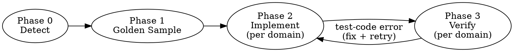
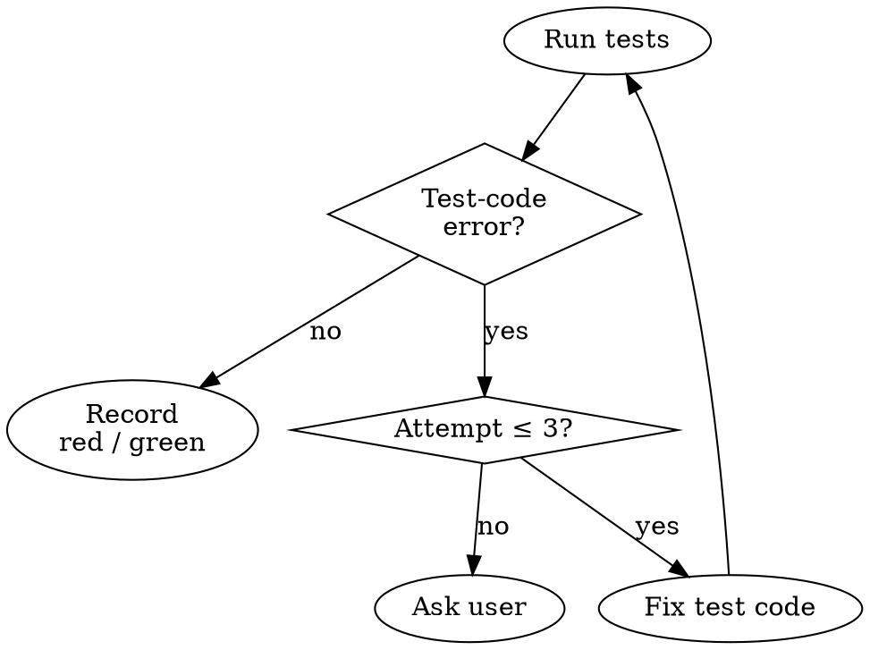

# Test Implementation Pipeline

## Pipeline Overview



## Phase 0: Detection

Auto-detect from project files. Do NOT ask user.

| Signal | Extract |
|--------|---------|
| `package.json` scripts.test | jest, vitest, mocha, playwright |
| `pyproject.toml`, `requirements*.txt`, `pytest.ini` | pytest |
| `pom.xml`, `build.gradle` | junit, testng |
| `tsconfig.json`, `jest.config.*`, `vitest.config.*` | TS test config |
| Existing test files (glob: `*test*`, `*spec*`, `*Test*`) | naming pattern, directory structure |

Output (internal): `{ language, framework, testRunner, testCommand, testFilePattern, testDir }`

## Phase 1: Golden Sample Extraction

Read 2-3 existing test files from the project. Extract:

1. **File structure**: imports, class/describe grouping, setup/teardown pattern
2. **Mock pattern**: how mocks are created (unittest.mock, jest.mock, Mockito, etc.)
3. **Fixture pattern**: shared data setup (pytest fixtures, beforeEach, @BeforeEach)
4. **Assertion style**: assert vs expect vs assertThat
5. **Instantiation pattern**: how SUT is created without dependencies (e.g., `object.__new__()`)

If scenarios file has "Implementation Notes" or "구현 주의사항" section, load it as **mandatory guards**.

## Phase 2: Domain-by-Domain Implementation

### Priority Order

1. Parse scenario file for priority groups (🔴 High → 🟡 Medium → 🟢 Low)
2. Within each priority, check dependency chains — implement dependencies first regardless of priority
3. Process ONE domain at a time

### Per Domain

For each domain:

1. **Read scenarios** for this domain from the scenarios file
2. **Decide target file**:
   - If existing test file covers this domain → modify it (add new test class/describe block)
   - If new domain → create new file following golden sample naming pattern
3. **Generate test code** following golden sample patterns exactly:
   - Same import style
   - Same mock/fixture patterns
   - Same assertion style
   - Same class/function naming convention
4. **Apply mandatory guards** from scenarios file (mock accuracy warnings, setup gotchas)

### Existing File Rules

When modifying existing test files:
- Re-read the file immediately before editing (context decay protection)
- Add new test classes/blocks — do NOT modify existing tests
- Re-run ALL tests in the file after modification (not just new ones)
- If any existing test breaks → revert and investigate

## Phase 3: Per-Domain Verification

After generating/modifying tests for ONE domain:

1. Run test command for that specific file
2. **Test-code error** (syntax, import, fixture, the runner does not collect the test) → fix the test code, re-run (max 3 attempts); 3 failures → report to user with error details, ask before continuing
3. **The test runs** → record it: green, or red with the failing assertion. Do not touch production code and do not loosen the assertion to make it pass. A red caused by your own setup (wrong fixture, wrong instantiation) is a test-code error, not a red.
4. Mark the domain complete and proceed to the next



## Completion

After all domains are verified:

1. Run full test suite (all test files, not just new ones). Existing tests that newly fail because this run changed shared test infrastructure → fix or revert that change.
2. Append the mapping to the scenarios file, one row per scenario, blocked ones included:

```markdown
## Test Mapping
| 시나리오 | 테스트 파일 | 테스트 이름 | 결과 |
|---|---|---|---|
| {scenario ID} | {path} | {test name} | green \| red: {judgment} \| [BLOCKED: {reason}] |
```

   `{judgment}` is `suspected product bug`, `scenario wrong` or `unclear`, followed by the failing assertion in a few words. A blocked row has `—` for file and name.
3. `git add` the test files in the table (no commit). If a file cannot be staged (ignored path), print `기준점 없음: {file}` and continue.
4. Report `도메인 N · 테스트 N · red N · green N · blocked N`, then each red row.
